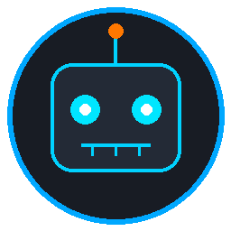

# OpenBot for Unraid OS

<p align="center">
  
</p>

<p align="center">
  <b>Unraid OS integration and automated daily multi-arch builds for <a href="https://github.com/nightly-labs/openbot">nightly-labs/openbot</a></b><br>
  A local-first desktop workspace for persistent AI teammates (Claude Code, Codex, Grok CLI, Gemini, Cursor CLI, Cline, etc.).
</p>

<p align="center">
  <a href="https://github.com/chmuri/openbot-unraid/actions"></a>
  <a href="https://github.com/chmuri/openbot-unraid/pkgs/container/openbot-unraid"></a>
  <a href="https://unraid.net"></a>
  <a href="LICENSE"></a>
</p>

---

## 🌟 Features

- 🤖 **Persistent AI Teammates:** Run Codex, Claude, Grok, Gemini, Cursor CLI, Cline, and custom ACP agents on your Unraid server.
- 🔄 **Daily Automated Builds:** Track upstream releases from [nightly-labs/openbot](https://github.com/nightly-labs/openbot) every 24 hours.
- ⚡ **Multi-Architecture:** Built for both `linux/amd64` and `linux/arm64`.
- 📁 **Unraid CA Ready:** Dedicated Community Applications template with persistent `/mnt/user/appdata/openbot` volume mapping.

---

## 🚀 Setup on Unraid

### 1. Add Template Repository in Unraid
1. In your Unraid WebGUI, navigate to the **Docker** tab.
2. Under **Template repositories** at the bottom, add:
   ```text
   https://github.com/chmuri/openbot-unraid
   ```
3. Click **Save**.
4. Click **Add Container** and select **OpenBot** from the *Template* list.
5. Click **Apply** to download and start the container.

### 2. Sign In to Your OpenBot Account
OpenBot runs as a background headless server and connects outbound to the OpenBot network.
After the container starts, open the **Unraid WebGUI Terminal** (or SSH) and run:

```bash
docker exec -it openbot openbot login
```

Follow the prompt to enter your email address and authentication code.

### 3. Connect via Web or Mobile App
Once signed in, access and collaborate with your AI agents at:
👉 **[https://openbot.run/app](https://openbot.run/app)** or via the official desktop and iOS apps.

To pair your mobile app directly:
```bash
docker exec -it openbot openbot mobile-connect
```

---

## ⚙️ Container Configuration

| Option | Value | Purpose |
| :--- | :--- | :--- |
| **Repository** | `ghcr.io/chmuri/openbot-unraid:latest` | Container image |
| **Appdata Storage** | `/mnt/user/appdata/openbot` &rarr; `/data` | All agent workspaces, queues, and databases |
| **Extra Parameters** | `--shm-size=1g --stop-timeout=60 --security-opt seccomp=unconfined --security-opt no-new-privileges:true` | Chromium shared memory & graceful shutdown |
| **Virtual Display** | `OPENBOT_DISPLAY_SIZE=1280x800` | Resolution for agent headless browser tasks |

---

## 📄 License and Attribution

- Unraid packaging and deployment scripts: Apache-2.0.
- Upstream OpenBot: Copyright Synthetify Labs, licensed under the [PolyForm Noncommercial License 1.0.0](https://github.com/nightly-labs/openbot/blob/main/LICENSE).
